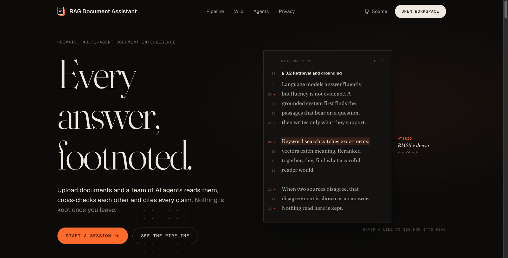
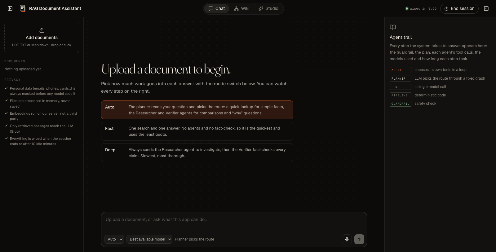
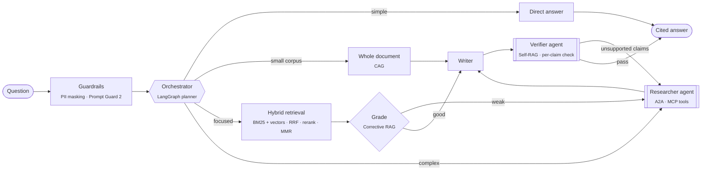

<p align="center">
  
</p>

<p align="center">
  <a href="https://rag-document-chatbot.vercel.app"></a>
  <a href="https://github.com/saiharsh11/RAG-Document-Chatbot/actions/workflows/ci.yml"></a>
  
  
  
  
  
</p>

<p align="center">
  <b>Upload documents. A team of AI agents reads them, cross-checks each other and cites every claim.<br>
  Nothing is kept once you leave.</b>
</p>

<p align="center">
  <a href="https://rag-document-chatbot.vercel.app"><b>Try it</b></a> ·
  <a href="docs/ARCHITECTURE.md"><b>Architecture</b></a> ·
  <a href="#-measured-not-assumed"><b>Results</b></a> ·
  <a href="#-run-it-locally"><b>Run locally</b></a>
</p>

<br>

<p align="center">
  
</p>

## ✦ What it does

|  |  |
|---|---|
| **Answers with receipts** | Every claim carries a citation. Click it and the PDF opens at that page with the passage highlighted. |
| **Agents you can watch** | A live trail shows each step: the guardrail, the plan, every tool call, the model used and how long it took. |
| **Session wiki** | An agent compiles your files into linked, cited concept pages, flags where documents contradict each other, and draws them as a graph you can drag, zoom and question. |
| **Studio** | Quizzes, flashcards, mind maps and study guides, each researched by an agent and kept for the whole session. |
| **Session memory** | Follow-ups like *"why did you suggest those?"* work even many messages later: earlier exchanges are recalled by meaning, locally. |
| **Voice** | Ask by voice (Whisper) and listen to answers (Orpheus, or your browser's voice). |
| **Private by design** | Personal data is masked before any model sees it. Sessions live in memory and are wiped after 10 idle minutes, with a one-minute warning. |

<p align="center">
  
</p>

## ✦ How it thinks



Words are used carefully here, because they matter in interviews and in code review:

| Component | What it really is |
|---|---|
| **Researcher, Verifier, Librarian** | **Agents**: the model chooses which tool to call, reads the result and decides again, inside a step budget |
| **Orchestrator** | A **planner**: an LLM picks one route through a fixed LangGraph graph, and code checks the choice |
| Guardrails | A pipeline stage: regex PII masking plus Meta's Llama Prompt Guard 2 classifier |
| Retriever | Deterministic code, no LLM |
| Writer | A single streamed model call |

Agents get their tools over **MCP** from a server built per request and scoped to one session, with no file, shell or network tools. The Orchestrator delegates to them over **A2A** (Agent Cards + JSON-RPC). Everything runs in one process today; moving an agent to its own service is a change of URL.

## ✦ Measured, not assumed

Retrieval on **BEIR SciFact**: 5,183 abstracts and 300 human-labelled queries, using the app's own components.

| Retrieval setup | nDCG@10 | Recall@100 |
|---|---|---|
| BM25 only | 0.667 | 0.886 |
| Dense only (bge-small) | 0.713 | 0.942 |
| Hybrid (RRF) | 0.707 | 0.965 |
| Hybrid + MiniLM reranker | 0.695 | 0.965 |
| Hybrid + bge-reranker-base | 0.719 | 0.965 |
| **Hybrid + Jina reranker (shipped)** | **0.737** | **0.965** |

The first reranker made results *worse* on scientific text, so it was replaced after measuring. The BM25 baseline matches the published SciFact figure (about 0.665), which validates the harness. Reproduce with `python eval/beir_eval.py`.

End to end, the real agents scored 1.00 answer correctness, 1.00 citation precision and 0.97 faithfulness (LLM judge) on 16 labelled questions over a synthetic corpus. That set is small, private and was used for debugging, so treat it as a regression test, not an accuracy claim. Details: [REPORT.md](backend/eval/results/REPORT.md).

## ✦ Under the hood

<details>
<summary><b>Retrieval</b>: adaptive chunking, hybrid search, small-to-big</summary>
<br>

- **Adaptive chunking by size:** semantic splitting up to 20 pages, heading-aware recursive splitting with overlap up to 300, and section-first (hierarchical) retrieval beyond that.
- **Contextual headers:** every chunk is indexed as *"Document › Section › Subsection"* plus its text.
- **Hybrid search:** BM25 and `bge-small` embeddings fused with Reciprocal Rank Fusion, then a Jina cross-encoder reranks the top 20, and MMR removes near-duplicates.
- **Small-to-big:** small chunks are searched; the model reads a window of the surrounding section.
- **Local models:** embeddings and reranking run on the server with ONNX (FastEmbed). Documents never go to an embedding API.
</details>

<details>
<summary><b>Free-tier engineering</b>: fallbacks, token buckets, circuit breakers</summary>
<br>

- Each job (answer, research, verify, route) has its own **fallback chain** across open-weight models, so per-model quotas add up.
- A **token bucket per model** mirrors Groq's rate-limit headers; the client waits for quota instead of failing, and shows the wait in the trail.
- A **circuit breaker** backs off from failing models.
</details>

<details>
<summary><b>Privacy</b>: what is and isn't stored</summary>
<br>

- No accounts, no database, nothing on disk. Uploads are parsed in memory; each session has an unguessable id and is wiped on exit or after 10 idle minutes.
- PII (emails, phones, Luhn-checked card numbers, IBANs, SSNs, IPs) is always masked locally, before chunking.
- Injected instructions inside documents are removed sentence by sentence at upload.
- The honest limit: the passages needed for an answer are sent to Groq for inference.
</details>

## ✦ Stack

| Layer | Technology |
|---|---|
| Agents | LangGraph, custom tool-calling loop, MCP (`mcp` SDK), A2A (`a2a-sdk`) |
| Models | `gpt-oss-120b`, `gpt-oss-20b`, `qwen3.8-27b`, Llama Prompt Guard 2, Whisper, Orpheus (Groq) |
| Retrieval | FastEmbed / ONNX (`bge-small-en-v1.5`, `jina-reranker-v1-turbo-en`), `rank-bm25`, NumPy |
| Backend | FastAPI, server-sent events, PyMuPDF |
| Frontend | React 19, Vite, pdf.js |
| Quality | pytest, BEIR benchmark, RAGAS-style LLM-judge evaluation, GitHub Actions |
| Hosting | Railway (API), Vercel (web) |

## ✦ Run it locally

```bash
# backend
cd backend
python -m venv .venv && .venv/bin/pip install -r requirements.txt
cp .env.example .env                       # add GROQ_API_KEY
.venv/bin/uvicorn main:app --port 8000

# frontend (another terminal)
cd frontend
echo "VITE_API_URL=<backend URL>" > .env.development.local
npm install && npm run dev                 # workspace at /app
```

<details>
<summary><b>Project layout</b></summary>

```
backend/app/agents      Orchestrator (LangGraph), Researcher / Verifier / Librarian agents, agent loop
backend/app/a2a_net     A2A Agent Cards, servers and client
backend/app/tools       MCP tool server (one per request) and client
backend/app/retrieval   local embeddings + reranker, hybrid index, retrieval pipeline
backend/app/ingest      parsing and adaptive chunking
backend/app/guard       PII masking, prompt-injection defence
backend/app/llm         Groq client with fallbacks and rate-limit handling
backend/eval            BEIR benchmark and end-to-end evaluation scripts
frontend/src/workspace  the app: chat, agent trail, wiki graph, studio, PDF viewer
```
</details>

<br>
<p align="center"><sub>Every answer, footnoted. Then it forgets.</sub></p>
